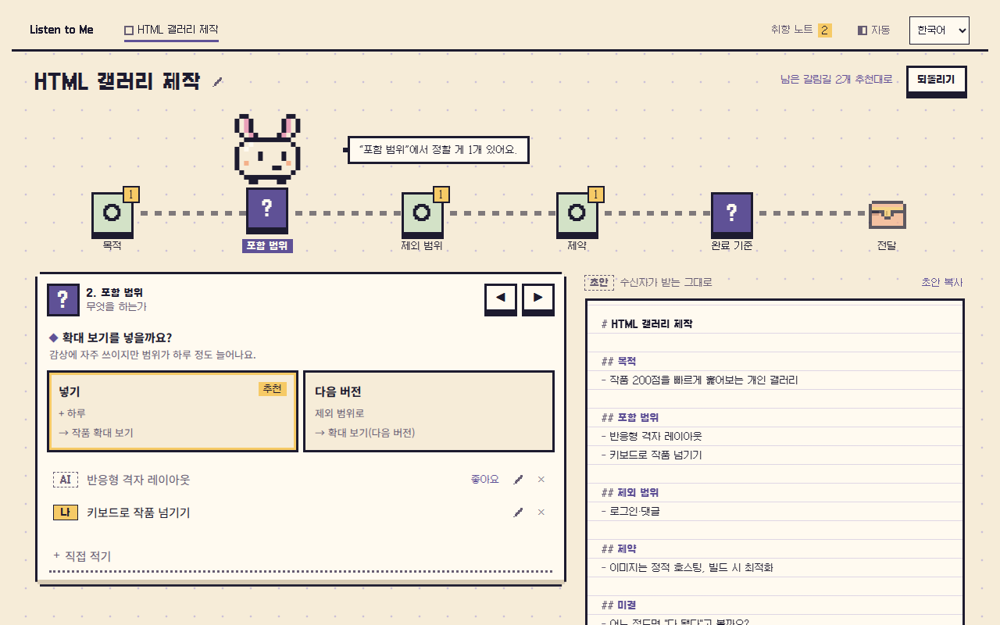
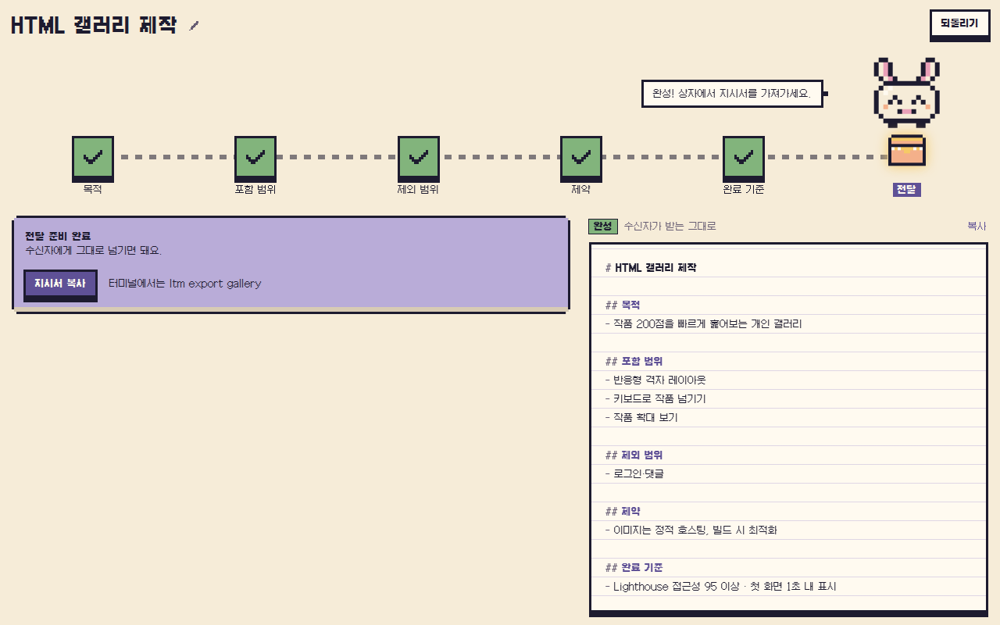
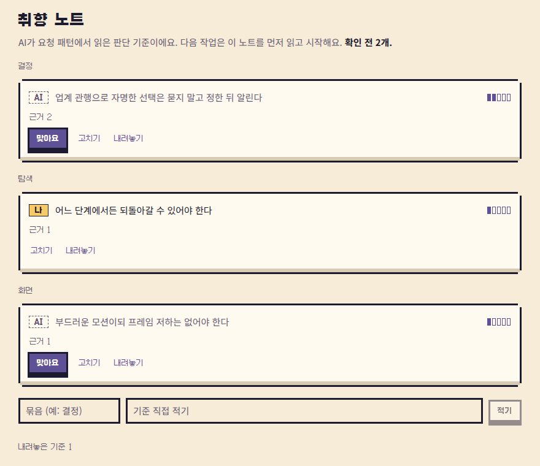
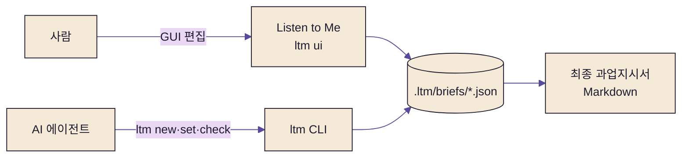

<div align="center">


# listeneeLTM

**Listen to Me — AI와 같은 화면에서 함께 쓰는 과업지시서**

지식수준이나 입력량과 관계없이, 누구나 중급 이상의 프롬프트·과업지시서를 만들게 하는 프로젝트 설치형 라이브러리


[작동 방식](#how) · [빠른 시작](#start) · [구조](#structure) · [문서](#docs)

<br/>



<sub>AI가 채운 초안을 단계별 여정 지도로 따라가며, 갈림길을 고르면 오른쪽 초안이 바로 바뀝니다.</sub>

</div>

---

##  왜 LTM인가

> "LTM으로 과업지시서 써보자"

평소 쓰는 AI 대화창에서 이 한마디면 됩니다. AI가 프로젝트 맥락을 반영한 초안을 GUI에 채우고, 사람과 AI가 **같은 데이터를 함께 편집**합니다.

| 기능 | 설명 |
| - | - |
|  **여정 지도** | 빠진 항목·갈림길·막힌 단계를 화면에서 바로 확인 |
|  **공동 편집** | AI는 CLI로, 사람은 GUI로 같은 지시서를 고치고, 누가 바꿨는지 기록 |
|  **취향 노트** | AI가 작업 중 드러난 판단 기준을 근거와 함께 기록하고 다음 지시서에 반영, 사람은 확인·수정만 |
|  **바이너리 하나** | 사용자 PC에 Node 같은 런타임 불필요, `ltm` 단일 실행 파일 |
|  **호스트 무관** | MCP 등록 없이 셸·파일을 다루는 모든 AI 에이전트에서 동작 |

##  화면

<table>
<tr>
<td width="50%"></td>
<td width="50%"></td>
</tr>
<tr>
<td align="center"><b>완성</b> — 모든 단계를 통과하면 상자에서 지시서를 꺼냅니다</td>
<td align="center"><b>취향 노트</b> — AI가 읽은 판단 기준을 확인·수정합니다</td>
</tr>
</table>

##  작동 방식 <a id="how"></a>



1. `ltm init` — `.ltm/AGENTS.md`(AI용 사용 안내)를 만들고 프로젝트 `AGENTS.md`에 안내 한 줄을 등록합니다.
2. AI가 안내를 읽고 `ltm new`로 초안을 만들고, `ltm set`으로 채웁니다(JSON 출력).
3. 사람은 `ltm ui`로 같은 지시서를 보며 고치고, 막힌 단계를 함께 풉니다.
4. `ltm export`로 완성된 지시서를 Markdown으로 꺼냅니다.

지시서는 평범한 JSON 파일이라 Git으로 이력을 남기고 비교할 수 있습니다.

##  빠른 시작 <a id="start"></a>

최초 공개 배포 준비 중입니다. 게시 후 프로젝트 폴더에서 실행합니다.

```bash
pnpm add -D listenee-ltm
pnpm exec ltm init
pnpm exec ltm ui
```

`init`은 기존 안내 파일을 보존하며 AI 안내를 등록합니다. `ui`는 브라우저 화면을 엽니다.

**Node·npm 없는 PC**도 단독 실행 파일로 설치할 수 있습니다. Linux x64·macOS arm64:

```sh
curl -fsSL https://github.com/pollux-o4/listeneeLTM/releases/download/v0.1.0/install.sh | sh && "$HOME/.local/bin/ltm" init && "$HOME/.local/bin/ltm" ui
```

Windows x64·PowerShell:

```powershell
& ([scriptblock]::Create((Invoke-WebRequest -UseBasicParsing https://raw.githubusercontent.com/pollux-o4/listeneeLTM/v0.1.0/scripts/install/install.ps1).Content)); if ($?) { ltm init; if ($LASTEXITCODE -eq 0) { ltm ui } }
```

설치 위치·PATH·실패 복구는 `docs/operations/`의 `OPS-001`, 개발 환경은 `tech-spec.md`에서 확인합니다.

<details>
<summary><b>CLI 명령</b></summary>

| 명령 | 용도 |
| - | - |
| `ltm init` | AI 안내 등록 |
| `ltm new · list · check · set · undo · export` | 지시서 작성·검사·되돌리기·내보내기 |
| `ltm pref show · json · set` | 취향 노트 |
| `ltm ui [--port 4318]` | GUI 실행(127.0.0.1 전용) |

프로젝트 루트는 `--project` 또는 `LTM_PROJECT_ROOT`(기본 현재 폴더)로 지정합니다.

</details>

<details>
<summary><b>개발 명령</b></summary>

| 명령 | 용도 |
| - | - |
| `pnpm check` | Rust·UI·저장소 검사 전체 (push 전 자동 실행) |
| `pnpm gen:types` | Rust 타입·스토리 데이터 → `ui/src/generated` |
| `pnpm gen:copy-screens` | 문구 → 화면 연결 생성 |
| `pnpm build` | UI 빌드 후 `target/release/ltm` |

</details>

##  구조 <a id="structure"></a>

```
crates/ltm-cli ──▶ crates/ltm-server ──▶ crates/ltm-core
                                              │ ts-rs
ui (React) ◀── ui/src/generated ◀─────────────┘
```

| 단위 | 역할 |
| - | - |
| `ltm-core` | 도메인 원본: 판정·조립·최종 지시서 |
| `ltm-server` | 파일 저장(원자 쓰기·잠금·되돌리기) + 루프백 HTTP |
| `ltm-cli` | AI용 명령 |
| `ui` | Listen to Me GUI (React 19 · Vite · Storybook) |

##  문서 <a id="docs"></a>

`docs/`는 위에서 아래로 읽습니다.

| 관심사 | 폴더 | 탐색 키 |
| - | - | - |
| 왜·누구·이상향 | `product/` | `VISION-` |
| 구조 | `architecture/` | `C1`, `C2` |
| 계약 | `specs/` | `FLOW-`, `DATA-`, `UX-` |
| 선택 이유 | `decisions/` | `ADR-` |
| 운영 | `operations/` | `OPS-` |

기술 기준은 [`tech-spec.md`](tech-spec.md), 작업 규칙은 [`AGENTS.md`](AGENTS.md).

##  상태

초기 개발 중입니다. API·파일 형식·명령은 바뀔 수 있습니다.
